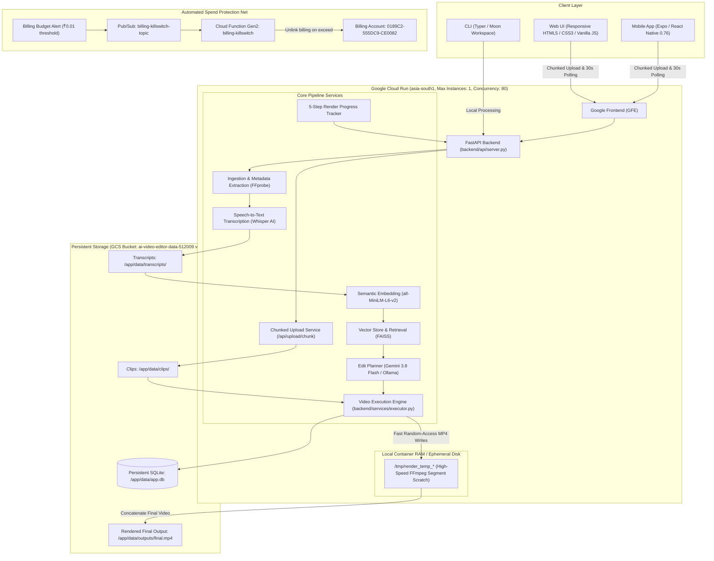

# 🎬 AI Video Editor

An intelligent, AI-powered video editing platform that takes multiple video clips and a natural language editing prompt to automatically generate edited videos with smart segment selection, pacing, and aspect ratio formatting.

Operates in **Dual Modes**:
- 🌐 **Production Cloud Mode**: Hosted on **Google Cloud Run** with **Google Gemini 3.8 Flash**, persistent SQLite on Cloud Storage volume mounts, resilient chunked uploads, and an **Expo / React Native mobile app** — all with a **$0 idle zero-cost architecture** and **automated billing killswitch protections**.
- 💻 **Local-First Mode**: Runs completely offline using local models (**Whisper**, **FAISS**, **Ollama / LLaMA 3**, and **FFmpeg**) with zero external API dependencies.

---

## 🌐 Live Production Service

- **Live Web Application**: **[https://ai-video-editor-backend-379657549399.asia-south1.run.app](https://ai-video-editor-backend-379657549399.asia-south1.run.app)**
- **Region**: `asia-south1` (Mumbai, India)
- **Active Revision**: `ai-video-editor-backend-00004-jxd`
- **Cost**: **$0.00 / month idle** (`--min-instances 0`, persistent SQLite on Cloud Storage volume mount)

---

## ✨ Key Features

- **Prompt-to-Video Editing**: Describe the style, mood, or narrative in plain English (e.g. *"create a fast-paced vertical highlight reel with snappy transitions"*).
- **Dual AI Planning**:
  - **Cloud**: Google Gemini (`gemini-3.8-flash`) for rapid, structured JSON edit plan reasoning.
  - **Local**: Ollama (`llama3` / `mistral`) for 100% offline workflow.
- **Resilient Chunked Uploads**: High-speed chunked uploading (`/api/upload/chunk`) in 20 MB slices, safely bypassing Cloud Run's 32 MB request limit for large video files.
- **Live 5-Step Progress Tracking**: Real-time progress monitoring across scanning, Whisper transcription, semantic retrieval, Gemini planning, and FFmpeg assembly.
- **Tab Close / Reopen State Recovery**: Closing or refreshing the browser tab never loses render progress; the UI queries active state on load and resumes the 30-second polling cycle.
- **HTTP 429 Prevention & High Concurrency**: Container concurrency tuned to 80 with non-overlapping 30-second client polling (`setTimeout`), eliminating Cloud Run request aborts.
- **Local `/tmp` Scratch Acceleration**: Intermediate FFmpeg clips are trimmed in local container scratch storage, eliminating GCSFuse network latency and `OutOfOrderError` issues.
- **Cross-Platform Mobile App**: Complete React Native & Expo application (`mobile/`) with camera roll picking, keychain auth, and native sharing.
- **Zero-Cost Database Architecture**: SQLite database persisted directly on a Google Cloud Storage volume mount (`/app/data/app.db`), completely eliminating Cloud SQL charges.
- **Multi-Tier Spend Protections**: Built-in Cloud Run spend cap + automated account-wide billing killswitch via Pub/Sub and Cloud Functions.

---

## 🏗️ System Architecture



---

## 🚀 Quick Start

### Option A: Use the Live Production Web App
Directly access the live web application:
👉 **[https://ai-video-editor-backend-379657549399.asia-south1.run.app](https://ai-video-editor-backend-379657549399.asia-south1.run.app)**

1. Register or sign in via the user profile modal.
2. Drag-and-drop or choose video clips (supports large files via chunked uploads).
3. Enter your prompt (e.g. *"highlight the best moments and export vertical 9:16"*).
4. Watch live 5-step progress and click **Download Final Video** when complete!

---

### Option B: Run the Mobile App (Expo / React Native)

The mobile application is located in `mobile/`:

```bash
cd mobile

# 1. Install dependencies
npm install

# 2. Configure endpoint in .env
cp .env.example .env
# Set: EXPO_PUBLIC_API_BASE_URL=https://ai-video-editor-backend-379657549399.asia-south1.run.app

# 3. Start Expo development server
npx expo start
```

- Scan the QR code using the **Expo Go** app on your iPhone or Android device.
- Or press `i` for iOS Simulator or `a` for Android Emulator.

---

### Option C: Run the Full Stack Locally

#### 1. System Requirements
- Python 3.12+ (or 3.13)
- FFmpeg (`brew install ffmpeg` or `sudo apt-get install ffmpeg`)
- Ollama (optional, for local LLM inference: `ollama run llama3`)

#### 2. Install & Start Backend
```bash
# Clone the repository
git clone https://github.com/worrzell/ai-video-editor.git
cd ai-video-editor

# Install dependencies via Poetry or pip
pip install -r backend/requirements.txt

# Start the FastAPI server
uvicorn backend.api.server:app --reload --host 0.0.0.0 --port 8000
```
Open **`http://localhost:8000`** in your browser.

---

## 🛠️ CLI Workflow (Local-First Mode)

For terminal power users and batch video pipelines, use the built-in CLI:

```bash
# 1. Scan and ingest clips
python backend/main.py ingest ./data/clips/

# 2. Transcribe speech using Whisper AI
python backend/main.py process --whisper-model small

# 3. Index segment embeddings into FAISS
python backend/main.py index --embedding-model all-MiniLM-L6-v2

# 4. Generate structured edit plan with LLM
python backend/main.py plan "create a dynamic highlight reel" --ollama-model llama3

# 5. Render final video via FFmpeg
python backend/main.py render --output-path ./data/outputs/final.mp4
```

---

## 📡 REST API Reference

| Method | Endpoint | Description |
|---|---|---|
| `POST` | `/api/auth/register` | Create a new user account with hashed password |
| `POST` | `/api/auth/login` | Authenticate user; returns JWT token & sets HttpOnly cookie |
| `POST` | `/api/auth/logout` | Clear authentication session |
| `GET` | `/api/auth/me` | Fetch active user profile and database status |
| `GET` | `/api/status` | List uploaded clips, check output status, and active model |
| `POST` | `/api/upload/chunk` | Upload video file in resilient 20 MB chunks |
| `POST` | `/api/render` | Trigger 5-step video generation & rendering pipeline |
| `GET` | `/api/render/progress` | Poll active render step, percent, and status message |
| `GET` | `/api/download/output` | Download the final rendered video file |
| `GET` | `/api/clips/{clip_name}` | Stream an uploaded raw clip |

---

## 🛡️ Cloud Deployment & Zero-Cost Architecture

The production environment on **Google Cloud Platform** is engineered to remain **$0.00 / month** when idle while strictly enforcing budget ceilings:

### 1. Scaling & Concurrency Safeguards
- `--min-instances 0`: Scales down to zero instances when traffic stops, incurring zero compute cost.
- `--max-instances 1`: Strict instance ceiling prevents horizontal auto-scaling surges.
- `--concurrency 80`: High container concurrency accommodates static assets and 30-second progress polls while rendering, preventing HTTP 429 drops.

### 2. Zero-Cost Persistent Database
- Replaces expensive Cloud SQL instances with a persistent **SQLite** database file stored directly on the Google Cloud Storage bucket mount (`/app/data/app.db`).
- Zero database hourly fees, zero VPC connectors, zero password management overhead.

### 3. Multi-Tier Spend Protections
- **Layer 1: Native Cloud Run Spend Cap**: Pauses invocations non-destructively when monthly budget is reached without affecting storage data.
- **Layer 2: Automated Billing Killswitch**: Cloud Function Gen2 (`billing-killswitch`) automatically unlinks the GCP billing account if spend exceeds ₹0.01.
- **1-Command Recovery**:
  ```bash
  bash scripts/relink-billing.sh --all <BILLING_ACCOUNT_ID>
  ```

---

## 🧪 Testing & Code Quality

Run the test suites:

```bash
# Backend unit & integration tests
pytest backend/tests

# Mobile frontend typechecking
cd mobile && npx tsc --noEmit
```

---

## 📁 Repository Structure

```
ai-video-editor/
├── backend/
│   ├── main.py                 # CLI entry point (Typer)
│   ├── requirements.txt         # Python dependencies
│   ├── api/
│   │   ├── server.py           # FastAPI routes & progress state
│   │   └── static/             # Responsive Web UI (HTML, CSS, JS)
│   ├── auth/                   # JWT auth, security, and SQLite user records
│   ├── services/
│   │   ├── ingestion.py        # Metadata extraction via FFprobe
│   │   ├── transcription.py    # OpenAI Whisper speech-to-text
│   │   ├── embedding.py        # Sentence-transformers embedding provider
│   │   ├── indexing.py         # FAISS vector store indexer
│   │   ├── retrieval.py        # Semantic prompt segment search
│   │   ├── planner.py          # Gemini 3.8 Flash & Ollama edit planner
│   │   ├── executor.py         # FFmpeg video assembly (uses /tmp scratch)
│   │   └── ffmpeg_runner.py    # FFmpeg trimming & concatenation
│   ├── models/
│   │   └── edit_plan.py        # Pydantic schemas (EditPlan, ClipSegment)
│   └── tests/                  # Pytest test suite
├── mobile/                     # React Native / Expo mobile app
│   ├── App.tsx                 # Tab navigation root
│   └── src/                    # Screens (Upload, Render, Library, Profile)
├── spec/                       # Complete architectural specifications
├── scripts/                    # GCP deployment, killswitch, and recovery scripts
├── .github/workflows/          # Continuous deployment (deploy.yml)
├── Dockerfile                  # Cloud Run multi-stage Docker container
└── README.md                   # Repository documentation
```

---

## 📄 License

MIT License — see [LICENSE](LICENSE) for details.
