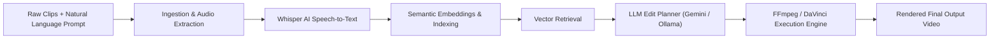

# AI Video Editing Tool — Technical Specification

## 1. Goal

Build an AI-powered video editing platform that:

* Accepts multiple raw video clips (via CLI, Web UI, or Mobile App)
* Accepts a natural language editing prompt
* Automatically generates a rough-cut edited video with smart segment selection, pacing, and aspect ratio formatting
* Supports dual operating modes:
  1. **Local-First / Offline Mode**: Uses local models (Whisper, FAISS, Ollama / LLaMA 3) with zero external network dependencies.
  2. **Production Cloud Mode**: Hosted on Google Cloud Run with Google Gemini AI (`gemini-3.8-flash`), persistent SQLite on Cloud Storage volume mounts, and an Expo/React Native mobile application.

---

## 2. Core Concept & Pipeline



---

## 3. System Architecture

### 3.1 Modules

1. **Ingestion Service**: Scans directory or receives multipart/chunked video files, validates formats (`.mp4`, `.mov`, `.avi`, `.mkv`), and extracts audio and technical metadata (duration, FPS, resolution) via FFprobe.
2. **Chunked Upload Handler**: Handles large media uploads in 20 MB chunks via `/api/upload/chunk`, bypassing Cloud Run's 32 MB HTTP payload ceiling.
3. **Transcription Service**: Automatic speech-to-text using OpenAI Whisper (`small` model by default) to produce segment-level timestamps and text.
4. **Context Store (Vector Index)**: Builds segment embeddings using `sentence-transformers` (`all-MiniLM-L6-v2`) and indexes them using FAISS.
5. **Retrieval Service**: Converts user prompt into an embedding vector and retrieves the top-$k$ most semantically relevant clip segments.
6. **LLM Planner**: Formulates a structured JSON edit plan:
   - **Cloud Mode**: Google Gemini API (`gemini-3.8-flash`) with strict JSON schema enforcement and automatic fallback.
   - **Local Mode**: Ollama (`llama3`) via structured prompt engineering.
7. **Execution Engine (`backend/services/executor.py`)**:
   - Trims selected segments using local `/tmp` scratch disk to prevent GCSFuse out-of-order write latency.
   - Concatenates segments via FFmpeg with aspect ratio formatting (e.g., 9:16 vertical, 16:9 widescreen).
   - Optional export to DaVinci Resolve project format.
8. **Live Render Progress Subsystem**:
   - 5-step progress tracking (`/api/render/progress`).
   - Web & Mobile clients poll every 30 seconds using non-overlapping `setTimeout`.
   - Automatic state recovery on tab close, reopen, or page reload.
9. **API Layer (`backend/api/server.py`)**: FastAPI application providing REST endpoints, JWT authentication, and serving the responsive Web UI.
10. **Mobile Application (`mobile/`)**: Cross-platform iOS/Android app built with React Native 0.76.5 and Expo SDK 52.

---

## 4. Tech Stack

| Domain | Cloud Production Mode | Local-First Mode |
|---|---|---|
| **Runtime** | Python 3.13 / FastAPI / Uvicorn | Python 3.12+ / Typer CLI / Moon |
| **Hosting & Compute** | Google Cloud Run (4 vCPU, 8 GB RAM) | Local Workstation / Laptop |
| **LLM Inference** | Google Gemini (`gemini-3.8-flash`) | Ollama (`llama3` / `mistral`) |
| **Speech Transcription** | OpenAI Whisper (`small` model) | OpenAI Whisper (`tiny`, `base`, `small`) |
| **Embeddings & Search** | `sentence-transformers` + FAISS | `sentence-transformers` + FAISS |
| **Storage & Persistence** | GCS Bucket (`gcsfuse` volume at `/app/data`) | Local filesystem (`./data/`) |
| **Database** | SQLite at `/app/data/app.db` ($0 cloud DB charges) | Local SQLite (`./data/app.db`) |
| **Video Processing** | FFmpeg 6+ / FFprobe (local `/tmp` scratch) | FFmpeg 6+ / DaVinci Resolve Studio |
| **Mobile Frontend** | Expo SDK 52 / React Native 0.76 / TypeScript | N/A |
| **Cost Controls** | Cloud Run Spend Cap + Pub/Sub Billing Killswitch | ₹0 / $0 |

---

## 5. Folder Structure

```
ai-video-editor/
├── backend/
│   ├── main.py                 # CLI entry point (Typer)
│   ├── requirements.txt         # Core dependencies
│   ├── api/
│   │   ├── server.py           # FastAPI server & route handlers
│   │   └── static/             # Responsive Web UI (HTML, CSS, JS)
│   ├── auth/                   # JWT auth, password hashing, and user models
│   ├── services/
│   │   ├── ingestion.py        # Video ingestion & metadata extraction
│   │   ├── transcription.py    # Whisper speech-to-text integration
│   │   ├── embedding.py        # Sentence-transformers embedding provider
│   │   ├── indexing.py         # FAISS vector store indexing
│   │   ├── retrieval.py        # Semantic prompt segment search
│   │   ├── planner.py          # Gemini / Ollama LLM edit plan generator
│   │   ├── executor.py         # FFmpeg video assembly (uses /tmp scratch)
│   │   └── ffmpeg_runner.py    # Low-level FFmpeg & FFprobe invocations
│   ├── models/
│   │   └── edit_plan.py        # Pydantic schemas (EditPlan, ClipSegment, StyleConfig)
│   └── tests/                  # Pytest unit & integration tests
├── mobile/                     # React Native / Expo mobile application
│   ├── App.tsx
│   ├── src/screens/            # Upload, Render, Library, Profile
│   └── src/api/                # HTTP API client with SecureStore JWT auth
├── data/                       # Local or GCS-mounted persistent storage
│   ├── clips/                  # Raw uploaded video clips
│   ├── transcripts/            # Segment transcript JSONs
│   ├── outputs/                # Rendered final video outputs
│   └── app.db                  # Persistent SQLite database
├── spec/                       # Architecture & design specifications
├── scripts/                    # GCP deployment, killswitch, and billing scripts
├── Dockerfile                  # Container definition for Cloud Run
└── README.md                   # Repository documentation
```

---

## 6. End-to-End Execution Flow

### Step 1: Clip Ingestion & Chunked Upload
- Users upload video files via Web UI or Mobile App.
- Files are transmitted in 20 MB chunks via `POST /api/upload/chunk` to stay well under Cloud Run's 32 MB payload limit.
- Assembled videos are stored in `data/clips/` on the persistent volume.

### Step 2: Speech Transcription (Whisper)
- Audio tracks are extracted from all ingested clips.
- OpenAI Whisper processes the audio and outputs segment timestamps and transcriptions:
  ```json
  {
    "clip_id": "clip_01.mp4",
    "segments": [
      { "start": 0.0, "end": 4.5, "text": "Welcome to the project demo." }
    ]
  }
  ```

### Step 3: Semantic Indexing & Vector Search
- Transcript segments are encoded into 384-dimensional dense vectors using `all-MiniLM-L6-v2`.
- Vectors are stored in a FAISS index (`data/embeddings.index`).
- The user's editing prompt is encoded and matched against segment embeddings using cosine similarity to select the top-$k$ most relevant segments.

### Step 4: AI Edit Planning
- The prompt and candidate segments are passed to the LLM (Gemini 3.8 Flash in cloud mode or Ollama locally).
- The LLM returns a strict, non-hallucinated `EditPlan` adhering to the Pydantic schema:
  ```json
  {
    "timeline": [
      { "clip_id": "clip_01.mp4", "start": 12.3, "end": 25.0, "reason": "highlight" }
    ],
    "style": {
      "pace": "fast",
      "captions": false,
      "aspect_ratio": "9:16"
    }
  }
  ```

### Step 5: FFmpeg Video Assembly
- Intermediate trimmed clips are generated in local container scratch storage (`/tmp/render_temp_*`) to avoid GCSFuse latency and out-of-order write errors.
- FFmpeg concatenates the clips with aspect ratio filters and audio synchronization.
- The final video is written to `data/outputs/final.mp4` on persistent storage and recorded in the SQLite database.

### Step 6: 30-Second Polling & Tab Recovery
- While rendering executes, progress is tracked across 5 steps:
  1. Scanning & Ingesting Clips (10%)
  2. Transcribing Audio with Whisper AI (35%)
  3. Semantic Indexing & Segment Retrieval (55%)
  4. AI Edit Planning with Gemini (75%)
  5. FFmpeg Video Assembly (90% - 100%)
- Web and mobile clients poll `GET /api/render/progress` every 30 seconds using non-overlapping `setTimeout`.
- If a user closes or refreshes the tab, opening the app queries the active progress and automatically resumes live monitoring.

---

## 7. Spending Protections & Cloud Safeguards

1. **Scale-to-Zero (`--min-instances 0`)**: The Cloud Run container completely shuts down when idle, resulting in ₹0 compute costs.
2. **Hard Instance Ceiling (`--max-instances 1`)**: Cloud Run will never launch multiple instances, preventing runaway scaling.
3. **Concurrency 80**: Accommodates static asset requests and 30-second progress polls alongside long renders without HTTP 429 drops.
4. **Native Cloud Run Spend Cap**: Built-in GCP Billing Budget pauses invocations when the monthly spend target is reached.
5. **Automated Billing Killswitch**: Cloud Function Gen2 triggered via Pub/Sub unlinks the billing account if spending exceeds ₹0.01.
