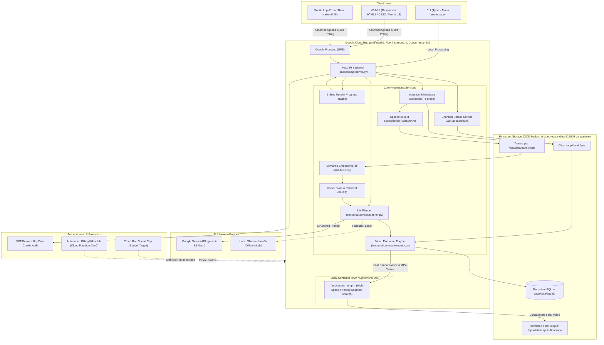

# Architecture Diagram — AI Video Editor

## System Overview

The diagram below illustrates the end-to-end architecture of the AI Video Editor platform across Web, Mobile, Cloud Run, AI inference providers, and persistent storage.

---

## Component Details

### 1. Client Layer
- **Web UI**: Built with modern responsive HTML/CSS/JS. Supports drag-and-drop chunked uploads (20 MB chunks), live 5-step progress visualization, and automatic polling recovery when closing and reopening tabs.
- **Mobile App**: Cross-platform iOS/Android app built with Expo SDK 52 and React Native 0.76. Features native video picking (`expo-image-picker`), keychain auth (`expo-secure-store`), and native sharing (`expo-sharing`).
- **CLI**: Typer-based command line workflow for offline developer usage and batch processing.

### 2. Google Cloud Run Engine
- **Single-Instance Hard Ceiling (`--max-instances 1`)**: Ensures the container never auto-scales into multiple instances, eliminating the risk of unexpected cloud compute bills.
- **Scale-to-Zero (`--min-instances 0`)**: Automatically shuts down container instances when idle, incurring ₹0 / $0 compute costs.
- **80-Slot Container Concurrency**: Allows static asset delivery and 30-second progress polls to be served with zero latency and zero HTTP 429 drops while long-running renders execute.

### 3. Scratch Disk vs. Persistent Storage Isolation
- **Local Scratch (`/tmp`)**: Intermediate FFmpeg video segments are trimmed and processed in local container storage. This eliminates `BufferedWriteHandler.OutOfOrderError` and network latency from Cloud Storage FUSE.
- **Persistent Storage (`/app/data`)**: Cloud Storage bucket mounted via `gcsfuse` ensures that SQLite database records, uploaded source clips, transcripts, and final rendered videos persist indefinitely across container restarts.

### 4. Dual AI Planning
- **Cloud Mode**: Google Gemini API (`gemini-3.8-flash`) provides sub-second structured JSON edit plan generation with high reasoning capacity.
- **Offline Mode**: Ollama (`llama3`) allows the entire pipeline to function completely disconnected from the internet.
