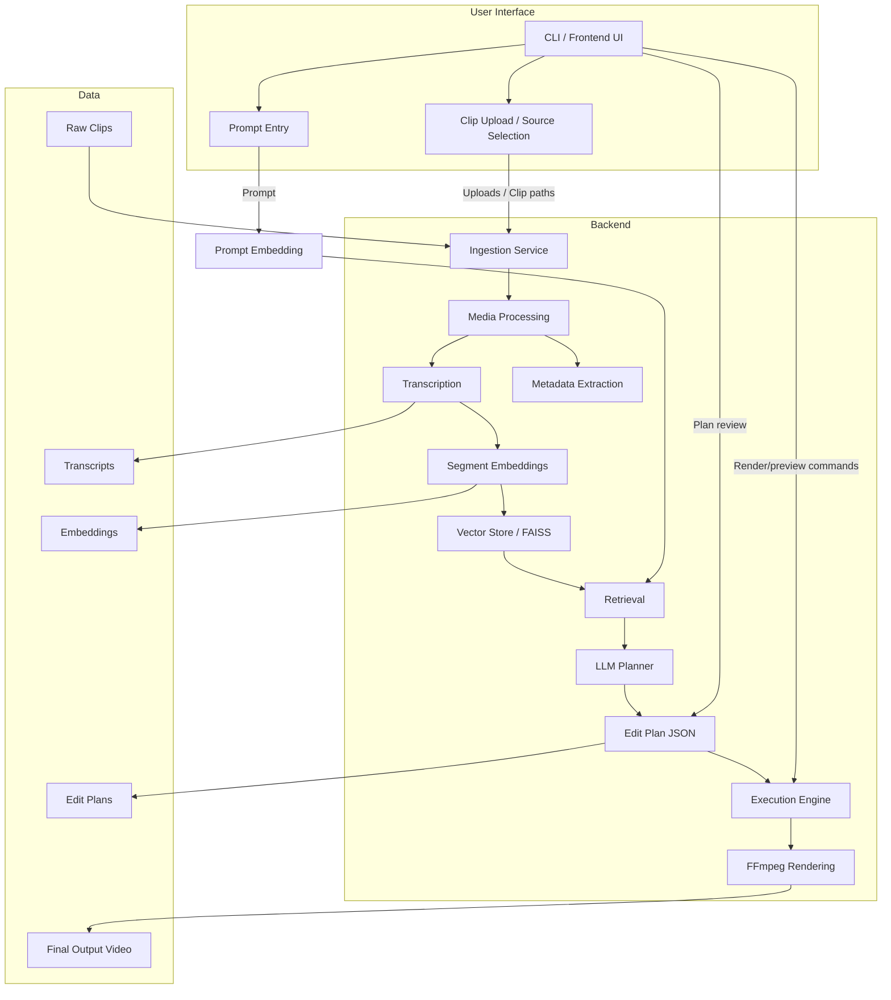

# Architecture Diagram

## System Overview

The diagram below shows the core pipeline for the local-first AI video editing tool, including the optional UI layer.

## Components

- `CLI / Frontend UI` — user-facing interaction layer for clip ingestion, prompt input, and render control.
- `Ingestion Service` — loads clips, validates formats, and extracts metadata with FFprobe/FFmpeg.
- `Media Processing` — orchestrates transcription and metadata normalization for each clip.
- `Transcription` — generates segment-level text data using Whisper locally.
- `Metadata Extraction` — parses clip duration, fps, resolution, and other video properties.
- `Segment Embeddings` — converts transcript segments to embedding vectors.
- `Vector Store / FAISS` — stores segment embeddings and metadata for retrieval.
- `Retrieval` — matches the user prompt to relevant transcript segments.
- `Prompt Embedding` — converts the edit request into vector space for retrieval.
- `LLM Planner` — builds a strict JSON edit plan using Ollama and retrieved segments.
- `Edit Plan JSON` — structured DSL defining timeline, clip segments, and style.
- `Execution Engine` — trims selected segments and manages FFmpeg composition.
- `FFmpeg Rendering` — concatenates trimmed clips and applies aspect ratio/output formatting.
- `Output Video` — the final rendered file saved to the output directory.

## UI Layer

- The UI layer can initially be a CLI implemented in `backend/main.py`.
- Future UI can be a lightweight web frontend or desktop interface that interacts with the same backend pipeline.
- The UI layer is responsible for:
  - selecting clips or clip directories
  - entering natural language prompts
  - previewing generated edit plan metadata
  - triggering processing, generation, and render commands

## Notes

- This architecture is aligned with `spec/01-core-architecture.md`.
- The UI layer is intentionally separate from the backend pipeline to keep the architecture modular.
- Mermaid diagrams are used for all architecture-level spec files.
