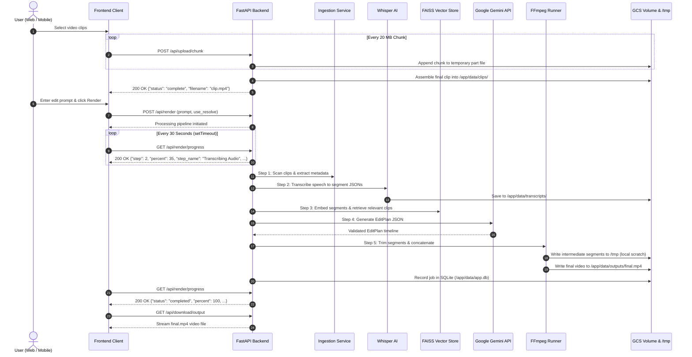

# API and Data Flow Specification

## Overview

This document specifies the REST API endpoints, request/response contracts, and data movement across the AI Video Editor system.



---

## Detailed API Endpoints

### 1. Authentication Endpoints

#### `POST /api/auth/register`
Creates a new user account.
- **Request Body (JSON):**
  ```json
  {
    "username": "creator",
    "password": "securepassword123"
  }
  ```
- **Response (200 OK):**
  ```json
  {
    "status": "success",
    "message": "Account 'creator' created successfully!",
    "token": "eyJhbGciOiJIUzI1NiIsInR5cCI6IkpXVCJ9...",
    "user": { "id": "uuid", "username": "creator", "role": "user" }
  }
  ```
- **Cookies:** Sets HttpOnly `access_token` cookie for web clients.

#### `POST /api/auth/login`
Authenticates a user and issues a JWT token.
- **Request Body (JSON):** `{"username": "...", "password": "..."}`
- **Response (200 OK):** Same as register; mobile clients persist the `token` in `expo-secure-store`.

#### `POST /api/auth/logout`
Logs out the user and clears authentication cookies.

#### `GET /api/auth/me`
Returns current session authentication status and database engine.

---

### 2. Media Upload Endpoints

#### `POST /api/upload/chunk`
Uploads files in resilient 20 MB chunks to bypass Cloud Run's 32 MB payload limit.
- **Headers:** `Content-Type: multipart/form-data`, `Authorization: Bearer <token>`
- **Form Fields:**
  - `file`: Binary chunk blob
  - `filename`: e.g., `"drone_shot.mp4"`
  - `chunk_index`: Zero-indexed integer (`0, 1, 2, ...`)
  - `total_chunks`: Total number of parts
- **Response (200 OK):**
  - In-progress chunk: `{"status": "chunk_received", "chunk_index": 0, "total_chunks": 5}`
  - Final chunk: `{"status": "complete", "filename": "drone_shot.mp4", "message": "Successfully uploaded drone_shot.mp4."}`

---

### 3. Render & Progress Endpoints

#### `POST /api/render`
Initiates the AI-driven editing and rendering pipeline.
- **Headers:** `Content-Type: application/x-www-form-urlencoded`, `Authorization: Bearer <token>`
- **Form Fields:**
  - `prompt`: String natural language edit description (e.g. `"create a fast-paced highlight reel"`)
  - `use_resolve`: Boolean flag (`true` to export DaVinci Resolve project, `false` for FFmpeg rendering)
- **Response (200 OK):**
  ```json
  {
    "status": "completed",
    "output_url": "/api/download/output",
    "plan": {
      "timeline": [...],
      "style": { "pace": "fast", "captions": false, "aspect_ratio": "9:16" }
    }
  }
  ```

#### `GET /api/render/progress`
Polls the live status of the rendering pipeline.
- **Polling Cadence:** 30 seconds (`30000ms`) via non-overlapping `setTimeout`.
- **Response (200 OK):**
  ```json
  {
    "status": "processing",
    "step": 3,
    "total_steps": 5,
    "percent": 55,
    "step_name": "Semantic Indexing",
    "message": "Building semantic index and searching relevant segments...",
    "error": null
  }
  ```
- **Lifecycle Statuses:** `idle`, `processing`, `completed`, `failed`.
- **Tab Reopen Support:** If a user closes or refreshes their browser during rendering, `GET /api/render/progress` returns the active step and allows the UI to resume tracking immediately.

---

### 4. Status & Delivery Endpoints

#### `GET /api/status`
Returns service status, list of uploaded clips, and whether a final output exists.
- **Response (200 OK):**
  ```json
  {
    "clips": ["clip1.mp4", "clip2.mov"],
    "output_exists": true,
    "download_url": "/api/download/output",
    "authenticated": true,
    "user": { "username": "creator" },
    "database": "sqlite",
    "model": "gemini-3.8-flash"
  }
  ```

#### `GET /api/download/output`
Streams the final rendered video file (`final.mp4`) as an attachment for browser download or mobile saving.
