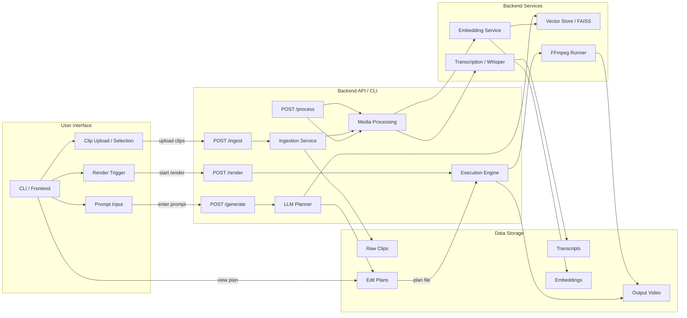

# API and Data Flow Diagram

## Overview

This diagram shows how the UI layer, backend services, and data storage interact through API endpoints and CLI commands.

## Components

- `CLI / Frontend` — sends ingest/process/generate/render requests through API or CLI.
- `POST /ingest` — registers clip sources and triggers ingestion.
- `POST /process` — runs transcription and embedding pipeline.
- `POST /generate` — creates an edit plan from prompt and retrieved segments.
- `POST /render` — executes the final render pipeline and creates output video.
- `Vector Store / FAISS` — stores embeddings and supports retrieval.
- `Transcription / Whisper` — transcribes clip audio to text segments.
- `Embedding Service` — converts text into vectors for retrieval.
- `FFmpeg Runner` — trims, concatenates, and renders video segments.

## Notes

- This spec assumes a unified CLI and API design where CLI commands call the same backend service logic.
- The diagram is intentionally high-level and focused on data movement between UI, API, and storage.
