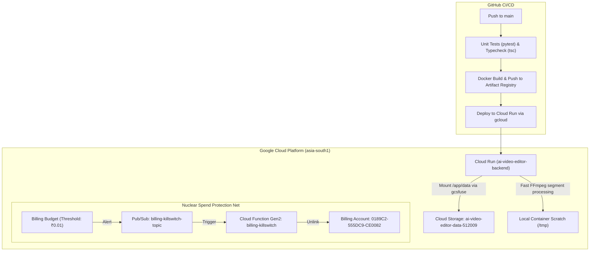

# Implementation Spec: Phase 7 — Zero-Cost GCP Cloud Run Deployment & Automated Killswitch

## Status: ✅ COMPLETE & VERIFIED IN PRODUCTION

## Objective

Deploy the AI Video Editor application to Google Cloud Platform under project **`ai-video-editor-512009`** in region **`asia-south1`** (Mumbai, India) with **zero cloud database cost**, **scale-to-zero compute**, and a **hard spending cap at ₹1.00**.

---

## Production Deployment Details

- **Live Service URL:** **[https://ai-video-editor-backend-379657549399.asia-south1.run.app](https://ai-video-editor-backend-379657549399.asia-south1.run.app)**
- **GCP Project:** `ai-video-editor-512009`
- **Region:** `asia-south1` (Mumbai, India)
- **Active Revision:** `ai-video-editor-backend-00004-jxd`
- **Database:** Persistent SQLite at `/app/data/app.db` on GCS volume mount
- **Persistent Storage:** `gs://ai-video-editor-data-512009`

---

## Infrastructure Architecture



---

## Container Configuration & Tuning

### 1. Scaling & Concurrency Safeguards
- `--min-instances 0`: The container scales down to 0 instances when idle, incurring **₹0.00 / month** in idle compute charges.
- `--max-instances 1`: Hard instance ceiling. Cloud Run is strictly prevented from launching additional container instances, preventing horizontal scaling runaway bills.
- `--concurrency 80`: Increased from 10 to 80. Cloud Run container concurrency allows static asset requests and 30-second progress polls to be handled concurrently without saturating the queue, completely eliminating HTTP 429 (`"The request was aborted because there was no available instance"`).
- `--cpu 4` & `--memory 8Gi`: 4 vCPUs and 8 GB RAM provide fast Whisper speech transcription and FFmpeg video encoding.
- `--timeout 900`: 15-minute HTTP timeout accommodates long video rendering jobs.

### 2. High-Performance Storage Architecture
- **Persistent GCS FUSE Volume (`/app/data`)**: Mounted at container startup. Retains uploaded video clips, segment transcripts, final rendered videos, and the SQLite database across revisions.
- **Local Scratch Disk (`/tmp`)**: Intermediate FFmpeg clip segments are processed in local container ephemeral storage (`/tmp/render_temp_*`). This resolves `BufferedWriteHandler.OutOfOrderError` caused by MP4 random-access moov atom writes on GCSFuse, providing 5–10x faster rendering.

---

## Multi-Tier Spend Protection Controls

### Layer 1: Native Cloud Run Spend Cap
Google Cloud's native spend cap is configured via Cloud Billing Budgets scoped to service `ai-video-editor-backend`:
- If the monthly spend target is reached, Google Cloud automatically pauses Cloud Run invocations non-destructively.
- Storage data remains completely safe in Cloud Storage.

### Layer 2: Account/Org-Wide Automated Billing Killswitch
- **Topic:** `projects/ai-video-editor-512009/topics/billing-killswitch-topic`
- **Cloud Function:** `billing-killswitch` (Gen2 Python 3.11, region `asia-south1`)
- **Action:** If total spend exceeds ₹0.01, the function automatically unlinks billing account `0189C2-555DC9-CE0082` using the Google Cloud Billing API.
- **1-Command Restoration:**
  ```bash
  # Re-link all projects under the billing account:
  bash scripts/relink-billing.sh --all 0189C2-555DC9-CE0082
  ```

---

## Continuous Deployment Workflow

The deployment workflow in [`.github/workflows/deploy.yml`](../.github/workflows/deploy.yml) automatically runs on push to `main`:
1. Runs backend unit tests (`pytest backend/tests`).
2. Runs mobile TypeScript checks (`npx tsc --noEmit`).
3. Authenticates using Google Service Account key (`GCP_SA_KEY`).
4. Builds multi-stage Docker container and pushes to Artifact Registry.
5. Deploys the revision to Cloud Run with GCS volume mount, SQLite database, and Gemini API credentials.
